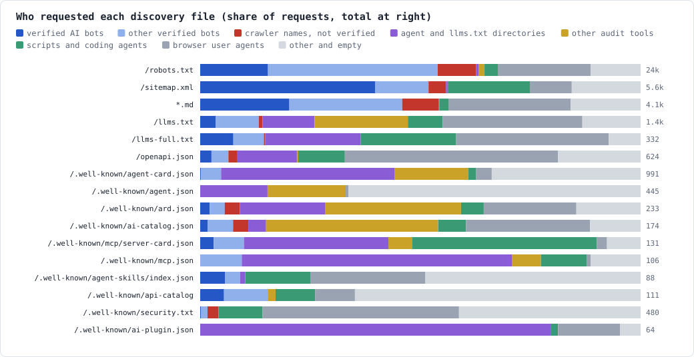

# Who reads the discovery files

*Field notes: 56 domains on Cloudflare, 7 days, October 17 to 24, 2026*

This standard asks sites to publish files for agents: llms.txt, an A2A agent card, MCP server cards, a skills index, an API catalog, markdown copies. Several of its levels rest on four to five days of logs from two sites (STANDARD.md §2). This is the same question asked of a whole network: across every domain one owner runs, for a week, who asked for each file, did the readers include the AI crawlers the files are written for, and did reading lead to using?

The portfolio is the one measured in the sister project's [Bots in AI clothing](https://github.com/geeks-accelerator/agent-security-pranks/blob/main/docs/research/bots-in-ai-clothing.md), a week earlier: local news sites, AI-agent platforms, small company and content sites, and parked domains, all on Cloudflare's Free plan. 49 of the 56 saw traffic. Counts are Cloudflare's sampled estimates.

## What we found

- **The AI crawlers read robots.txt and the sitemap, not llms.txt.** Verified AI bots made 3,644 robots.txt requests and 2,232 sitemap requests, 40% of all sitemap reads. They made 49 of the 1,406 llms.txt requests (3.5%). GPTBot asked for llms.txt 5 times in the week across 49 sites; ClaudeBot didn't ask once.
- **llms.txt is still read, by other readers.** Every one of the 49 sites was asked for it, though only 24 serve one. Its readers are browser user agents (446), other audit tools (298), directories (166), scripts and coding agents (111), and verified search and SEO bots (138), led by ExaSearchBot and Googlebot.
- **Some readers go on to use the API.** On the 16 sites with a working API or MCP endpoint, 70 of the 537 addresses that read llms.txt (13%) made a successful API or MCP call the same week, 49 of them (9%) with a user agent that wasn't a browser's. For openapi.json, 52 of 228 (23%), 37 not a browser's (16%). A browser user agent here can be a person reading the file and then using the site's own pages, which call its API.
- **Bots ask for markdown, by the thousand.** 12,601 requests got markdown at a URL that doesn't end in `.md`, which means they asked for it with `Accept: text/markdown`. Nearly all came from verified bots, and most from one: ExaSearchBot (11,596, 92%), then ShapBot (472), Exa's user-triggered fetcher (359) and KeenableBot (42). The behavior is real; how widespread it is rests mostly on one search engine.
- **Agent cards are read by directories, not AI crawlers.** agent-card.json got 991 requests at 22 sites, 8 of which serve one. Verified AI bots: 2. Directories made 391, other audit tools 165. The pre-1.0 path `/.well-known/agent.json` got 445 requests at 19 sites, and none serves it.
- **A hosted MCP endpoint is busy, mostly with monitors.** `/mcp` got 29,374 requests at 20 sites, 2 of which run one. Uptime monitors and MCP directories made 12,993 (mcpbeat, mcp-health-probe, rokmcp-collector, AgentRankProbe, Clono), Microsoft's Copilot Studio 6,248 (verified by Cloudflare), and node scripts 3,454.
- **Crawler names on `/api` are mostly fake.** Of 4,761 requests for `/api`, 3,420 sent a well-known AI or search crawler's name without being that crawler, at 44 sites, nearly all answered with a 4xx. That's the impostor the sister project's research found, still at work.
- **Audits are a large share of discovery traffic.** This project's audit and its sister's made 3,564 discovery requests in the week, more than all the week's llms.txt requests; they are removed from every number here. Other audit tools (Semrush, Ahrefs, agentprobe, agent-tools.cloud, Lumar) were the largest readers of ard.json and ai-catalog.json.

| | |
|---|---|
| **5.53M** | requests across 56 domains in the week |
| **306k** | from Cloudflare-verified AI crawlers, AI search and assistants (5.5%) |
| **1,406** | llms.txt requests; 49 from verified AI bots |
| **12,601** | markdown answers to agents that asked with `Accept` |
| **991** | agent-card.json requests; 2 from verified AI bots |
| **13%** | of llms.txt readers on API sites went on to call the API |

## Who reads each file

| File | Requests | Sites asked | Sites serving | Verified AI bots | Other verified bots | Crawler names, not verified | Directories | Other audit tools | Scripts | Browser user agents | Other |
|---|---|---|---|---|---|---|---|---|---|---|---|
| /robots.txt | 23,671 | 49 | 43 | 3,644 | 9,121 | 2,058 | 131 | 328 | 715 | 4,994 | 2,680 |
| /sitemap.xml | 5,622 | 48 | 36 | 2,232 | 683 | 222 | 22 | 2 | 1,047 | 535 | 879 |
| `*.md` | 4,135 | 34 | 15 | 837 | 1,060 | 344 | 2 | 2 | 90 | 1,144 | 656 |
| /llms.txt | 1,406 | 49 | 24 | 49 | 138 | 12 | 166 | 298 | 111 | 446 | 186 |
| /llms-full.txt | 332 | 18 | 13 | 25 | 23 | 1 | 72 | 0 | 72 | 115 | 24 |
| /openapi.json | 624 | 31 | 10 | 16 | 24 | 12 | 85 | 2 | 66 | 302 | 117 |
| /.well-known/agent-card.json | 991 | 22 | 8 | 2 | 45 | 0 | 391 | 165 | 18 | 35 | 335 |
| /.well-known/agent.json | 445 | 19 | 0 | 0 | 0 | 0 | 68 | 79 | 0 | 3 | 295 |
| /.well-known/security.txt | 480 | 46 | 14 | 1 | 7 | 12 | 0 | 0 | 48 | 214 | 198 |
| /.well-known/ard.json | 233 | 19 | 5 | 5 | 8 | 8 | 45 | 72 | 12 | 49 | 34 |
| /.well-known/ai-catalog.json | 174 | 16 | 5 | 3 | 10 | 6 | 7 | 68 | 11 | 49 | 20 |
| /.well-known/mcp/server-card.json | 131 | 4 | 3 | 4 | 9 | 0 | 43 | 7 | 55 | 3 | 10 |
| /mcp/server-card | 109 | 2 | 2 | 5 | 21 | 0 | 31 | 2 | 14 | 9 | 27 |
| /.well-known/api-catalog | 111 | 13 | 10 | 6 | 11 | 0 | 0 | 2 | 10 | 10 | 72 |
| /.well-known/mcp.json | 106 | 20 | 2 | 0 | 10 | 0 | 65 | 7 | 11 | 1 | 12 |
| /docs/api.md | 109 | 6 | 6 | 8 | 11 | 6 | 0 | 0 | 19 | 48 | 17 |
| /.well-known/agent-skills/index.json | 88 | 5 | 5 | 5 | 3 | 0 | 1 | 0 | 13 | 23 | 43 |
| /.well-known/ai-plugin.json | 64 | 21 | 1 | 0 | 0 | 0 | 51 | 0 | 1 | 9 | 3 |
| /auth.md | 30 | 6 | 6 | 2 | 5 | 1 | 0 | 0 | 14 | 7 | 1 |

"Verified AI bots" are Cloudflare's AI Crawler, AI Search and AI Assistant categories. Cloudflare files some AI search engines elsewhere: ExaSearchBot, the largest verified reader of llms.txt (48 requests) and of markdown, is in its Search Engine Crawler category, so it counts under "other verified bots" here. The verified readers of llms.txt by name: ExaSearchBot 48, PetalBot 18, Googlebot 14, Amazonbot 11, AgenstryBot 10, AhrefsBot 6, GPTBot 5, bingbot 2.

## Asked for versus served

Directories and tools ask every site for every file, so a request isn't a sign the file is wanted there. What the chart does show is that sites without a file still get asked: for agent-card.json, the old agent.json path, mcp.json and ai-plugin.json, more requests got a 404 or a redirect than got the file, so an honest JSON 404 (D7, D11) is most of what those paths answer.

## Reading, then using

| File | Readers | Called the API or MCP | Of them, not a browser user agent |
|---|---|---|---|
| /llms.txt | 537 | 70 (13%) | 49 |
| /openapi.json | 228 | 52 (23%) | 37 |
| /llms-full.txt | 151 | 16 (11%) | 10 |
| /.well-known/agent-card.json | 112 | 31 (28%) | 29 |
| /docs/api.md | 90 | 14 (16%) | 10 |
| /.well-known/agent-skills/index.json | 74 | 10 (14%) | 7 |
| /mcp/server-card | 50 | 20 (40%) | 13 |
| /.well-known/mcp/server-card.json | 24 | 9 (38%) | 8 |
| /auth.md | 17 | 7 (41%) | 4 |

Same address isn't proof of the same agent: several clients can share an address, and one agent can use several. And part of the high share for the MCP cards is directories that read a card, then check that `/mcp` answers. The number to take from it: a working agent reads the docs and then calls, which is why llms.txt and openapi.json matter on sites with an API, even though the AI crawlers mostly skip them.

## The endpoints

## What it suggests for the standard

These are proposals, for the owner to decide; none has been applied.

- **D4 (llms.txt) keeps its level, with a truer reason.** Its readers are directories, tools, scripts, search bots and people, not the AI crawlers; the AI crawlers follow robots.txt and the sitemap. On sites with an API, one in eight readers went on to call it, which is the reason to keep it required.
- **D8 (markdown for agents) has the evidence it was waiting for.** It's a next-level item because "none of our logs can show that traffic yet". This week, verified bots asked for markdown 12,601 times across the sites that serve it, 92% of them one crawler, Exa's. That's a case for recommended, with the concentration stated.
- **D1 and D2 have the strongest evidence of any item.** The AI crawlers read robots.txt and the sitemap more than any other file here.
- **D11's honest JSON 404 is the main answer the agent-card path gives.** 14 of the 22 sites asked for a card have none, and directories ask for the pre-1.0 path `/.well-known/agent.json` too: D7's catch-all should cover it.
- **The newer catalog files (D9's ARD and ai-catalog, A3's api-catalog) are read mostly by audit tools,** a handful of verified bots a week. Principle 3 says an item that only scanners look for is recommended at most; these are at that level, and this week's data doesn't argue for more.
- **T3 should expect audits in the logs.** Audit tools, this one included, are among the largest readers of discovery files; `--logs` names this audit's own requests, and other audit tools should be counted apart from agents.

## How we measured

- Cloudflare GraphQL Analytics (`httpRequestsAdaptiveGroups`) for all 56 zones, 2026-10-17 00:00 UTC to 2026-10-24 00:00 UTC, read through the owner's dashboard session.
- Discovery paths: the files above, any path under `/.well-known/` (except ACME challenges), any path ending in `.md`, and `/mcp`, `/api`, `/sse`, `/api/mcp`. Dimensions: path, user agent, Cloudflare's `verifiedBotCategory`, status, and the response's content type.
- "Verified" is Cloudflare's verified-bot category. Reader classes for unverified requests come from the user agent, the same way `--logs` classifies them; "crawler names, not verified" is a user agent naming a well-known AI or search crawler with no verification.
- Markdown by negotiation: a response Cloudflare types as markdown at a URL not ending in `.md` or `.txt`. The Free plan doesn't expose the `Accept` header (the field exists, but the zone has no access), so this counts the requests that asked and got markdown, and misses those that asked a site that doesn't serve it.
- Follow-through: on each site where some client got a 2xx from `/api/*` or `/mcp`, the addresses that read each file, compared in the browser with the addresses that made a successful call. Audit tools are removed on both sides. Addresses were never recorded.
- This project's audit (3,564 requests) and security-pranks-audit are removed from every count except the week's total.
- Limits: counts are sampled estimates; the Free plan has no bot score; a week is a week. The portfolio is one owner's, with many AI-agent platforms, so agent files get more traffic here than on a typical site.
- The data is in [data.json](who-reads-discovery-files/data.json) and the charts are rendered from it: `node docs/research/who-reads-discovery-files/charts.mjs`.

## How it compares

- **llms.txt readership:** Ahrefs found 97% of about 38,000 llms.txt files got no requests in May 2026, and bots made 96% of the rest ([Ahrefs](https://ahrefs.com/blog/llmstxt-study/), a vendor's own data). Here every site was asked for llms.txt, likely because agent directories crawl this portfolio. Google said on 2026-06-15 that Search ignores llms.txt ([Search Central](https://developers.google.com/search/docs/fundamentals/ai-optimization-guide)).
- **Adoption:** the 2025 Web Almanac found a valid llms.txt on about 2.1% of sites ([HTTP Archive](https://almanac.httparchive.org/en/2025/seo)); Cloudflare found markdown negotiation on 3.9% of the top 200,000 domains, and MCP server cards and API catalogs on fewer than 15 sites between them ([Cloudflare](https://blog.cloudflare.com/agent-readiness)).
- **Markdown requests:** Cloudflare reported in 2026 that only some coding agents send `Accept: text/markdown` by default ([Cloudflare](https://blog.cloudflare.com/agent-readiness)). We found no published count of how many requests ask; this is one.
- **What we found nowhere else:** who reads agent cards, MCP server cards and skills indexes, verified against spoofed readers of discovery files, and whether reading leads to using.

## Further reading

- [Bots in AI clothing](https://github.com/geeks-accelerator/agent-security-pranks/blob/main/docs/research/bots-in-ai-clothing.md), the same portfolio a week earlier: 448k vulnerability probes, none from a verified bot.
- [Cloudflare's verified bots](https://developers.cloudflare.com/bots/concepts/bot/verified-bots/), the program behind the verified-bot categories used here.
