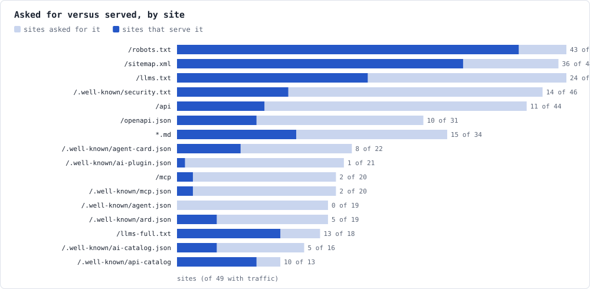
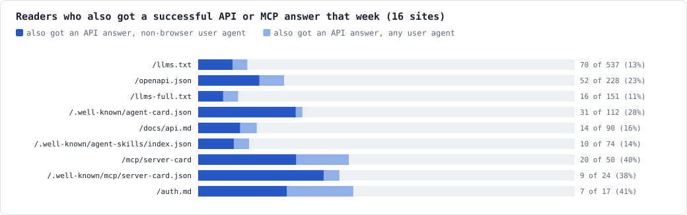
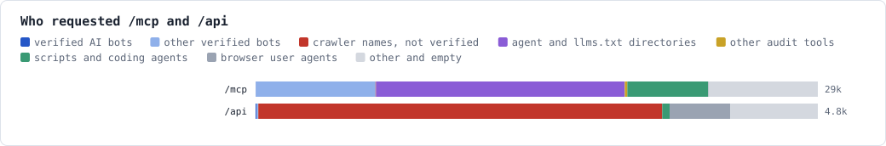

# Who requests agent discovery files?

*Field notes: 56 domains on Cloudflare, 7 days, October 17 00:00 to October 24 00:00 UTC, 2026. Corrected 2026-10-24 after outside review (see [Corrections](#corrections)).*

This standard asks sites to publish files for agents: llms.txt, an A2A agent card, MCP server cards, a skills index, an API catalog, markdown copies. Several of its levels rested on four to five days of logs from two sites (STANDARD.md §2). This asks the same question of a whole network: across every domain one owner runs, for a week, who requested each file, how many of those requests came from bots Cloudflare verifies, and how many readers also used the site's API.

The portfolio is the one measured in the sister project's [Bots in AI clothing](https://github.com/geeks-accelerator/agent-security-pranks/blob/main/docs/research/bots-in-ai-clothing.md), over a window that overlaps it for 161 of 168 hours (that study ran October 16 17:00 to October 23 17:00 UTC): two analyses of nearly the same traffic, with different questions. The sites are local news sites, AI-agent platforms, small company and content sites, and parked domains, all on Cloudflare's Free plan. 49 of the 56 saw traffic. Counts are Cloudflare's sampled estimates; small numbers are the least certain. The exact queries and the classifier are in [method.md](who-reads-discovery-files/method.md).

## What we found

- **Requests in Cloudflare's legacy AI categories went to robots.txt and the sitemap far more than to llms.txt.** Bots in the AI Crawler, AI Search and AI Assistant categories made 3,644 robots.txt requests and 2,232 sitemap requests (40% of all sitemap requests), and 49 of the 1,406 llms.txt requests (3.5%). In the sampled data, GPTBot requested llms.txt 5 times across 49 sites and ClaudeBot not at all. Those categories are narrower than "AI": since July 1, 2026, Cloudflare files new search crawlers under Search, and it files ExaSearchBot as a Search Engine Crawler. Counting Exa's 48 requests too, the share is 97 of 1,406 (6.9%); every verified bot together made 187 (13.3%).
- **llms.txt is still requested, mostly by other readers.** Every one of the 49 sites was asked for it, though only 24 serve one. Browser user agents made 446 requests, other audit tools 298, directories 166, verified bots outside the AI categories 138 (led by ExaSearchBot and Googlebot), and scripts and coding agents 111. Directories and audit tools together made a third (464).
- **Some readers also used the API.** On the 16 sites where some client got a successful API or MCP answer, 70 of the 537 addresses that requested llms.txt (13%) also got a successful API or MCP answer that week, 49 of them (9%) with a user agent that wasn't a browser's. For openapi.json: 52 of 228 (23%), 37 not a browser's (16%). This is overlap within the week, not a measured sequence (see [Reading and using](#reading-and-using)).
- **Bots asked for markdown by the thousand, mostly one search engine's.** 12,601 responses typed as markdown went to URLs ending in neither `.md` nor `.txt`. On the four portfolio sites tested that serve markdown at page URLs, a page returns markdown only when the request's `Accept` header asks for it: not for `*/*`, not with no `Accept`, and not for ExaSearchBot's user agent alone (tested 2026-10-24). 92% came from ExaSearchBot (11,596), 95% from Exa's two clients together (with its user-triggered fetcher, 359); then ShapBot (472) and KeenableBot (42). Without Exa, the total is 646. The behavior is real; how widespread it is rests mostly on one provider.
- **Agent cards are requested mostly by directories and audit tools.** agent-card.json got 991 requests at 22 sites, 8 of which serve one. Directories and audit tools made 556 (56%); bots in the AI categories made 2. The older path `/.well-known/agent.json`, which A2A had replaced with agent-card.json by version 0.3, got 445 requests at 19 sites, and none serves it.
- **A hosted MCP endpoint is busy, largely with monitors.** `/mcp` got 29,374 requests at 20 sites, 2 of which run one. Named uptime monitors and MCP directories were the largest group, 12,993 (44%): mcpbeat, mcp-health-probe, rokmcp-collector, AgentRankProbe and Clono. Microsoft's Copilot Studio made 6,248 (verified by Cloudflare), and node scripts 3,454. What those requests did beyond reaching the endpoint needs a method-level breakdown this data doesn't have.
- **Most requests for `/api` named a crawler they weren't verified as.** Of 4,761 requests for the literal path `/api`, 3,420 (71.8%) carried a well-known AI or search crawler's name without Cloudflare's verification, at 44 sites, nearly all answered with a 4xx. Unverified doesn't always mean fake; the sister study ties much of this pattern to one scanner rotating twenty crawler names.
- **Audits are a large share of discovery traffic.** This project's audit and its sister's made 3,564 discovery requests in the week, more than all the week's llms.txt requests; they are removed from every number here except the week's total. Other audit tools (Semrush, Ahrefs, agentprobe, agent-tools.cloud, Lumar, SEOJuice) were the largest readers of ard.json and ai-catalog.json.

| | |
|---|---|
| **5.53M** | requests across 56 domains in the week |
| **306k** | in Cloudflare's legacy AI categories (AI Crawler, AI Search, AI Assistant): 5.5% |
| **1,406** | llms.txt requests; 49 in the legacy AI categories, 187 from any verified bot |
| **12,601** | markdown responses at URLs not ending in `.md` or `.txt`; 92% to ExaSearchBot |
| **991** | agent-card.json requests; 556 from directories and audit tools |
| **13%** | of llms.txt readers on API sites also got a successful API answer that week (9% non-browser) |

## Who requests each file

| File | Requests | Sites asked | Sites serving | Legacy AI categories | Other verified bots | Crawler names, not verified | Directories | Other audit tools | Scripts | Browser user agents | Other |
|---|---|---|---|---|---|---|---|---|---|---|---|
| /robots.txt | 23,671 | 49 | 43 | 3,644 | 9,121 | 2,058 | 131 | 328 | 715 | 4,994 | 2,680 |
| /sitemap.xml | 5,622 | 48 | 36 | 2,232 | 683 | 222 | 22 | 2 | 1,047 | 535 | 879 |
| `*.md` | 4,135 | 34 | 15 | 837 | 1,060 | 344 | 2 | 2 | 90 | 1,144 | 656 |
| /llms.txt | 1,406 | 49 | 24 | 49 | 138 | 12 | 166 | 298 | 111 | 446 | 186 |
| /llms-full.txt | 332 | 18 | 13 | 25 | 23 | 1 | 72 | 0 | 72 | 115 | 24 |
| /openapi.json | 624 | 31 | 10 | 16 | 24 | 12 | 85 | 2 | 66 | 302 | 117 |
| /.well-known/agent-card.json | 991 | 22 | 8 | 2 | 45 | 0 | 391 | 165 | 18 | 35 | 335 |
| /.well-known/agent.json | 445 | 19 | 0 | 0 | 0 | 0 | 68 | 79 | 0 | 3 | 295 |
| /.well-known/security.txt | 480 | 46 | 14 | 1 | 7 | 12 | 0 | 0 | 48 | 214 | 198 |
| /.well-known/ard.json | 233 | 19 | 5 | 5 | 8 | 8 | 45 | 72 | 12 | 49 | 34 |
| /.well-known/ai-catalog.json | 174 | 16 | 5 | 3 | 10 | 6 | 7 | 68 | 11 | 49 | 20 |
| /.well-known/mcp/server-card.json | 131 | 4 | 3 | 4 | 9 | 0 | 43 | 7 | 55 | 3 | 10 |
| /mcp/server-card | 109 | 2 | 2 | 5 | 21 | 0 | 31 | 2 | 14 | 9 | 27 |
| /.well-known/api-catalog | 111 | 13 | 10 | 6 | 11 | 0 | 0 | 2 | 10 | 10 | 72 |
| /.well-known/mcp.json | 106 | 20 | 2 | 0 | 10 | 0 | 65 | 7 | 11 | 1 | 12 |
| /docs/api.md | 109 | 6 | 6 | 8 | 11 | 6 | 0 | 0 | 19 | 48 | 17 |
| /.well-known/agent-skills/index.json | 88 | 5 | 5 | 5 | 3 | 0 | 1 | 0 | 13 | 23 | 43 |
| /.well-known/ai-plugin.json | 64 | 21 | 1 | 0 | 0 | 0 | 51 | 0 | 1 | 9 | 3 |
| /auth.md | 30 | 6 | 6 | 2 | 5 | 1 | 0 | 0 | 14 | 7 | 1 |

The classes are exclusive: a request is "verified" if Cloudflare verifies it, whatever it does, so a verified Ahrefs request counts as verified, not as an audit tool. The `*.md` row includes `/docs/api.md` and `/auth.md`; don't add the rows into one total. The leading verified readers of llms.txt by name: ExaSearchBot 48, an unnamed Mozilla-compatible search crawler 27, PetalBot 18, Googlebot 14, Amazonbot 11, AgenstryBot 10, AhrefsBot 6, GPTBot 5; smaller ones make up the rest of the 187. Several files' largest class is "other": the reader is unidentified, which is a finding in itself (api-catalog: 72 of 111).

## Asked for versus served

Directories and tools ask every site for every file, so a request isn't a sign the file is wanted there. What the chart does show is that sites without a file still get asked: for agent-card.json, the older agent.json path, mcp.json and ai-plugin.json, more requests got a 404 or a redirect than got the file. A redirect can lead to a valid relocated file; this count doesn't follow it.

## Reading and using

| File | Readers | Also got an API or MCP answer | Of them, not a browser user agent |
|---|---|---|---|
| /llms.txt | 537 | 70 (13%) | 49 (9%) |
| /openapi.json | 228 | 52 (23%) | 37 (16%) |
| /llms-full.txt | 151 | 16 (11%) | 10 |
| /.well-known/agent-card.json | 112 | 31 (28%) | 29 |
| /docs/api.md | 90 | 14 (16%) | 10 |
| /.well-known/agent-skills/index.json | 74 | 10 (14%) | 7 |
| /mcp/server-card | 50 | 20 (40%) | 13 |
| /.well-known/mcp/server-card.json | 24 | 9 (38%) | 8 |
| /auth.md | 17 | 7 (41%) | 4 |

**What this measures:** same-week address overlap. For each of the 16 sites, the set of addresses that requested the file is compared with the set that got a 2xx from `/api/*` or `/mcp`, both without audit tools; the counts are those per-site sets, summed across sites. It does not measure order: an existing API user may read the docs afterward, and a directory may read a card and then check that `/mcp` answers, which accounts for part of the high share for the MCP cards. Several clients can share an address, and one client can use several. A 2xx from an API-looking path may be a health check or a fallback, and an MCP answer may carry a tool error. A browser user agent can be a person whose pages call the site's own API. And Cloudflare's sampling favors frequent clients, so these are not conversion rates and don't take ordinary confidence intervals.

The higher overlap for openapi.json than for llms.txt (1.75 times) fits a simpler explanation than one file working better: someone asking for an API specification already means to call the API.

## The endpoints

## What it suggests for the standard

These were proposals; STANDARD.md 2.2.0 adopted them, and 2.2.1 corrects their wording to match this version of the paper.

- **D4 (llms.txt) keeps its level, with a truer reason.** Its readers are directories, tools, scripts, search bots and people; the bots in the legacy AI categories mostly read robots.txt and the sitemap. On sites with an API, 13% of readers also got an API answer that week (9% non-browser). The stronger support is controlled: Mintlify's benchmark (below) found that markdown with a linked llms.txt cut agents' wasted fetches on documentation tasks.
- **D8 (markdown for agents) moved to recommended.** Bots asked for markdown 12,601 times across the sites that serve it, 92% of them Exa's crawler, matching GoodBarber's September finding (below). The concentration is stated in D8.
- **D1 and D2 have the strongest evidence of any item here.**
- **D7 and D11:** most requests for the agent-card paths reach sites without a card, so an honest JSON 404 is most of what those paths answer, the older agent.json included.
- **The newer catalog files (ard.json, ai-catalog.json) draw mostly audit tools; api-catalog's readers are mostly unidentified.** A request count doesn't decide a specification's standing: the API catalog is an IETF Standards Track RFC (RFC 9727), ARD a proposal.
- **T3 counts audits apart from agents.**

## How we measured

- Cloudflare GraphQL Analytics (`httpRequestsAdaptiveGroups`) for all 56 zones, 2026-10-17 00:00 UTC to 2026-10-24 00:00 UTC, read through the owner's dashboard session. The queries, filters, limits and the classifier are in [method.md](who-reads-discovery-files/method.md); no query hit its row limit.
- "Legacy AI categories" are Cloudflare's AI Crawler, AI Search and AI Assistant verified-bot categories, which Cloudflare kept after its July 1, 2026 taxonomy change. Reader classes for unverified requests come from the user agent.
- Markdown: a response Cloudflare types as `md` at a URL ending in neither `.md` nor `.txt`. The Free plan doesn't expose the `Accept` header to queries. On the four portfolio sites tested that serve markdown at page URLs (achurch.ai, animalhouse.ai, drifts.bot, geeksinthewoods.com), markdown comes back only when `Accept` asks for it, so a markdown answer there means the request asked; the other serving sites weren't tested. Cloudflare's own Markdown for Agents feature needs a paid plan, so on these Free-plan zones the negotiation is the sites' own code. The count misses requests that asked a site that doesn't serve markdown.
- This project's audit and security-pranks-audit (3,564 requests together) are removed from every count except the week's total.
- Limits: counts are sampled estimates, and small numbers ("ClaudeBot: none") mean none in the sample; the Free plan has no bot score; a week is a week; the window overlaps the sister study's. The portfolio is one owner's, with many AI-agent platforms and directory listings, so 49 active domains aren't 49 independent samples of the web, and agent files get more traffic here than on a typical site. Requests to subpath indexes (`/docs/llms.txt`) and to card URLs a catalog advertises elsewhere aren't counted.
- The data is in [data.json](who-reads-discovery-files/data.json), and the charts are rendered from it: `node docs/research/who-reads-discovery-files/charts.mjs`.

## How it compares

- **llms.txt readership:** Ahrefs found 97% of about 38,000 llms.txt files got no requests in May 2026, and bots made 96% of the rest; its totals include its own crawlers ([Ahrefs](https://ahrefs.com/blog/llmstxt-study/), a vendor's own data). Here every site was asked for llms.txt, likely because agent directories list and crawl this portfolio. Google said on 2026-06-15 that llms.txt doesn't affect Search; Googlebot may still fetch it ([Search Central](https://developers.google.com/search/docs/fundamentals/ai-optimization-guide)).
- **Markdown requests:** GoodBarber counted about 22,000 negotiated markdown requests in its own logs, September 4 to 18, 2026, almost all from ShapBot, ExaSearchBot and Claude Code, which asked for markdown on nearly every page ([GoodBarber](https://www.goodbarber.com/blog/do-ai-agents-read-markdown-what-two-weeks-of-our-own-server-logs-say-a1622/), 2026-09-22). This study agrees on who asks.
- **Whether it helps:** Mintlify's benchmark ran 2,400 attempts across 20 documentation sites, four formats, and Claude Code and Codex; markdown with a linked llms.txt cut wasted fetches (404s per task) from 2.23 with HTML to 0.11, with accuracy in the mid-to-high 90s in every format ([Mintlify](https://www.mintlify.com/blog/llms-txt-agent-benchmark), 2026-07-17). That is evidence about tasks, which request counts like these can't give.
- **Adoption:** the 2025 Web Almanac found a valid llms.txt on about 2.1% of sites, many generated by SEO plugins ([HTTP Archive](https://almanac.httparchive.org/en/2025/seo)); Cloudflare found markdown negotiation on 3.9% of the top 200,000 domains, and MCP server cards and API catalogs on fewer than 15 sites between them, as of April 2026 ([Cloudflare](https://blog.cloudflare.com/agent-readiness)).
- **What this adds:** one portfolio's requests for many discovery files at once, split by Cloudflare verification, with an overlap measure between reading and API use.

## Corrections

The first version, published earlier on 2026-10-24, said:
- the sister study's week came "a week earlier" and its impostor was "still at work"; the windows overlap for 161 of 168 hours;
- "verified AI bots" without saying these are Cloudflare's legacy categories, which leave out ExaSearchBot;
- readers "went on to call" the API; the method measures same-week overlap, not order;
- a markdown response "means they asked for it with `Accept`" without testing the sites; four were tested since;
- `.md` pages are read "mostly" by verified bots (46%), the catalog files "mostly" by audit tools (not api-catalog), and `/mcp` "mostly" by monitors (44%, the largest group);
- no published count of markdown requests existed; GoodBarber's did;
- `/.well-known/agent.json` was the "pre-1.0" path; it predates A2A 0.3.

## Further reading

- [Bots in AI clothing](https://github.com/geeks-accelerator/agent-security-pranks/blob/main/docs/research/bots-in-ai-clothing.md), the sister project's analysis of nearly the same week: 448k vulnerability probes, none from a verified bot.
- [Cloudflare's verified bots](https://developers.cloudflare.com/bots/concepts/bot/verified-bots/), including the July 1, 2026 taxonomy.
